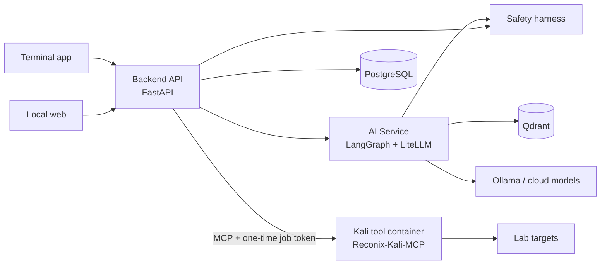

<div align="center">

# Reconix Core Backend

**AI-assisted pentesting that runs on your own computer. The AI suggests, the backend decides.**


[About](#about) •
[Tech stack](#tech-stack) •
[Repository layout](#repository-layout) •
[Getting started](#getting-started) •
[Checks and tests](#checks-and-tests) •
[Contributing](#contributing)

</div>

---

## About

Reconix is a pentest assistant that runs on the tester's own computer. You start by writing a
scope: what you are allowed to test, and how far you may go. An AI agent then plans the test and
suggests one step at a time. Each step you approve runs a real tool inside a locked-down Kali
container, and the results turn into findings, an analysis and finally a report you can download.

```
scope → plan → approve → run → analyze → validate → report → download
```

> [!IMPORTANT]
> **The AI never runs a tool by itself.** Every action it suggests goes through five safety
> checks, in this order: input, scope, command, risk and loop. Nothing may leave the approved
> scope, and anything rated `MEDIUM` or `HIGH` waits until a person approves it. Right before a
> tool actually runs, the API checks the action a second time.

### How the parts connect

The terminal app and the local web both talk to the backend API. The API stores everything in
PostgreSQL, asks the AI Service for plans and analysis, and is the only part allowed to call the
Kali container. It does so over MCP, with a fresh one-time job token for every run. The safety
harness sits between them: both the AI and the API run its checks.



## Tech stack

The **backend API** is written in Python 3.12 with FastAPI and Pydantic v2. It uses SQLAlchemy 2
and Alembic for the database, psycopg 3 as the Postgres driver, and Uvicorn as the server.

The **AI Service** uses LiteLLM to talk to any model, LangGraph to run the agent (it saves its
progress in Postgres), and LlamaIndex with Qdrant for the knowledge search. Report files are
made with Jinja2 and WeasyPrint (PDF) and python-docx (DOCX). Models run locally
through Ollama, or in the cloud through any provider LiteLLM supports.

The **safety harness** holds the five checks, the secret masking and the audit log, which is a
JSON-lines file.

The **tool container** is Kali Linux with nmap, nuclei, ZAP, semgrep and gitleaks, reached over
MCP.

The **terminal app** is built with Textual and Rich. The **local web** is Next.js 16 with React 19,
TypeScript and Tailwind CSS 4.

For tooling we use uv, ruff, pytest, Vitest, Playwright and Docker Compose.

## Repository layout

```
reconix-core-backend/
├── services/
│   ├── api/            # Backend API (reconix_api): routes → services → repositories → models
│   └── ai/             # AI Service (reconix_ai) and the safety harness
├── apps/
│   ├── tui/            # Terminal app
│   ├── web/            # Local web
│   └── sample-data/    # Shared fake data for the TUI and the web
├── deploy/             # Docker Compose files, lab, seed.sql, install.sh
└── docs/               # Team plan, openapi.json (generated), ERD V3
```

The Kali tool container and its MCP server live in their own repo, **Reconix-Kali-MCP**. This repo
never reaches into it: it talks to it only through MCP and pulls its image by tag.

## Getting started

You need Python 3.12 with [uv](https://docs.astral.sh/uv/), and Docker with Compose. Node.js 20 or
newer with npm is only needed if you want to run the local web.

### The quick way

Clone the repo, switch to `Main`, and run the dev script:

```bash
git clone git@github.com:14th-Generation-Advanced-Course/reconix-core-backend.git
cd reconix-core-backend
git checkout Main
./deploy/dev.sh
```

The first time, the script creates a `.env` file from `.env.example` and stops so you can fill it
in. Run it again once you have. From then on it installs the Python packages, starts Postgres,
Qdrant, Ollama and the Kali container, waits for Postgres to be ready, migrates the database, and
starts the API at http://127.0.0.1:8000. The Swagger UI is at `/docs`.

Press `Ctrl+C` to stop the API. The Docker services keep running; stop them with:

```bash
docker compose -f deploy/docker-compose.yml -f deploy/docker-compose.dev.yml --env-file .env down
```

If you would rather see each step, the rest of this section does the same thing by hand.

### 1. Clone and install

```bash
git clone git@github.com:14th-Generation-Advanced-Course/reconix-core-backend.git
cd reconix-core-backend
git checkout Main
uv sync
```

### 2. Configure

Copy the example settings and fill in the secrets:

```bash
cp .env.example .env
```

One of them is the Fernet key, which encrypts the AI provider API keys you save. You can make one
with:

```bash
uv run python -c "from cryptography.fernet import Fernet; print(Fernet.generate_key().decode())"
```

> [!CAUTION]
> Never commit `.env`. Only `.env.example` belongs in git.

### 3. Start the services

This starts Postgres, Qdrant, Ollama and the Kali container. Because the API runs on your computer
rather than inside Compose, also pass the dev file. It adds a small relay that makes the Kali MCP
port reachable on `127.0.0.1`. The port is `RECONIX_MCP_PORT`, 8765 by default; if it is taken,
change it and `RECONIX_KALI_MCP_URL` together.

```bash
docker compose -f deploy/docker-compose.yml -f deploy/docker-compose.dev.yml --env-file .env up -d
docker compose -f deploy/docker-compose.yml ps
```

The Kali container has no internet access, so nuclei cannot download its templates by itself. Run
this once, and again whenever you want newer templates:

```bash
docker compose -f deploy/docker-compose.yml --env-file .env run --rm nuclei-templates
```

### 4. Migrate the database and run the API

Run both commands from the repo root, so they read the root `.env`:

```bash
uv run --package reconix-api alembic -c services/api/alembic.ini upgrade head
uv run --package reconix-api python -m reconix_api.main
```

### 5. Check that it works

Every route lives under `/api/v1`. The health check is open; almost everything else needs a session
token, so the second call below should answer 401:

```bash
curl http://127.0.0.1:8000/api/v1/health           # {"status":"OK"}
curl -i http://127.0.0.1:8000/api/v1/sessions/x     # 401: routes need a session token
```

### If something goes wrong

**`password authentication failed for user "reconix"`**: Postgres keeps the password it was given
the first time it started. Make `RECONIX_DATABASE_URL` match `RECONIX_DB_PASSWORD`, or start over
with a fresh volume. Be careful: this deletes all data.

```bash
docker compose -f deploy/docker-compose.yml -f deploy/docker-compose.dev.yml --env-file .env down -v
```

**`Can't locate revision identified by '...'`**: the database was migrated from another branch.
Switch back to that branch, or reset the volume as above and migrate again.

**`address already in use` on port 8000**: the API is already running in another terminal. Stop
that one first.

**Another port is already taken**: change `RECONIX_MCP_PORT` and `RECONIX_KALI_MCP_URL` in `.env`,
or stop the container that is using it.

### Where everything runs

Everything listens on `127.0.0.1` only, so nothing is reachable from other machines. The API is at
http://127.0.0.1:8000 with its Swagger UI at http://127.0.0.1:8000/docs. PostgreSQL is on port 5432,
Qdrant at http://127.0.0.1:6333 and Ollama at http://127.0.0.1:11434. In development only, the Kali
MCP relay is at http://127.0.0.1:8765/mcp.

To run the terminal app or the local web, see [`apps/README.md`](apps/README.md).

## Checks and tests

Before you open a pull request, make sure lint and formatting pass, and run the tests for every
package you touched:

```bash
# lint and format
uv run ruff check . && uv run ruff format --check .

# tests, one package at a time
uv run --package reconix-api pytest
uv run --package reconix-ai  pytest
uv run --package reconix-tui pytest

# local web
cd apps/web && npm ci && npm run lint && npm run test
```

> [!NOTE]
> `docs/openapi.json` is generated from the FastAPI app. Never edit it by hand.

## Contributing

Start with [`AGENTS.md`](AGENTS.md). It explains the safety rules, the contracts between parts,
the code rules and what "done" means. Each part also has its own `AGENTS.md` under `services/` or
`apps/` with the rules for that part. [`docs/reconix-plan-v2.md`](docs/reconix-plan-v2.md) says who
does what and when, and [`docs/erd/reconix-erd-v3-final.md`](docs/erd/reconix-erd-v3-final.md) has
the exact table, column and enum names to use.

When you work on something, branch from `Develop` with a name like `feat/<task>`, `fix/<task>` or
`chore/<task>`. Write conventional commit messages that name the part, for example
`feat(api): chat messages per session`. Open your pull request against `Develop`; it needs green CI
and one review before it can be merged. Nobody pushes to `Main` or `Develop` directly.
