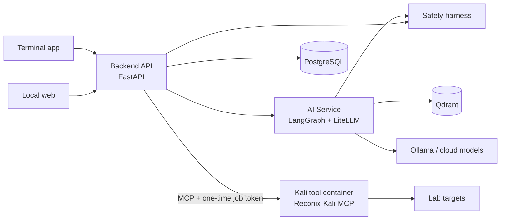

<div align="center">

# Reconix Core Backend

**AI-assisted pentesting that runs on your own computer. The AI suggests, the backend decides.**


[About](#about) •
[Tech stack](#tech-stack) •
[Repository layout](#repository-layout) •
[Getting started](#getting-started) •
[Checks and tests](#checks-and-tests) •
[Contributing](#contributing) •
[Contributors](#contributors)

</div>

---

## About

Reconix is an AI-assisted pentest tool that runs on the tester's own computer. A person writes a
scope, the AI agent plans the test and suggests each step, approved steps run real tools in a
locked-down Kali container, and the results become findings, analysis and a report.

```
scope → plan → approve → run → analyze → validate → report → download
```

> [!IMPORTANT]
> **The AI never runs a tool.** Every action goes through the safety checks
> (input → scope → command → risk → loop), stays inside the approved scope, and waits for a person
> when the risk is `MEDIUM` or `HIGH`. The API checks the action again right before the tool runs.

### How the parts connect



## Tech stack

| Part | Stack |
|---|---|
| **Backend API** | Python 3.12, FastAPI, Pydantic v2, SQLAlchemy 2, Alembic, Uvicorn, psycopg 3 |
| **AI Service** | LiteLLM, LangGraph (Postgres checkpoints), LlamaIndex, Qdrant |
| **Safety harness** | Input, scope, command, risk and loop checks; secret masking; JSON-lines audit log |
| **Data** | PostgreSQL 16, Qdrant |
| **Models** | Ollama locally, or a cloud provider through LiteLLM |
| **Tool container** | Kali Linux with nmap, nuclei, ZAP, semgrep and gitleaks, over MCP |
| **Terminal app** | Textual, Rich, Typer |
| **Local web** | Next.js 16, React 19, TypeScript, Tailwind CSS 4, xterm.js |
| **Tooling** | uv, ruff, pytest, Vitest, Playwright, Docker Compose |

## Repository layout

```
reconix-core-backend/
├── services/
│   ├── api/            # Backend API (reconix_api): routes → services → repositories → models
│   └── ai/             # AI Service (reconix_ai) and the safety harness
├── apps/
│   ├── tui/            # Terminal app
│   ├── web/            # Local web
│   └── sample-data/    # Shared fake data for the TUI and the web
├── deploy/             # Docker Compose files, lab, seed.sql, install.sh
└── docs/               # Team plan, openapi.json (generated), ERD V3
```

| Folder | Owner |
|---|---|
| `services/api/` | Vanneth |
| `services/api/.../parsers`, `findings`, `clients` | Youlong |
| `services/ai/` | Sakphearoth |
| `services/ai/.../harness/` | Pojim |
| `apps/tui/` | Vanhong |
| `apps/web/` | Sokpiseth |
| `deploy/` | Vanneth |
| `docs/` | Pojim |

The Kali tool container and its MCP server live in a separate repo, **Reconix-Kali-MCP**. This
repo talks to it only through MCP and pulls its image by tag.

## Getting started

### Requirements

- Python 3.12 and [uv](https://docs.astral.sh/uv/)
- Docker with Compose
- Node.js 20+ and npm (only for the local web)

### 1. Clone and install

```bash
git clone git@github.com:14th-Generation-Advanced-Course/reconix-core-backend.git
cd reconix-core-backend
git checkout Develop
uv sync
```

### 2. Configure

```bash
cp .env.example .env
```

Fill in the secrets in `.env`. To make the Fernet key that encrypts AI provider API keys:

```bash
uv run python -c "from cryptography.fernet import Fernet; print(Fernet.generate_key().decode())"
```

> [!CAUTION]
> Never commit `.env`. Only `.env.example` belongs in git.

### 3. Start the services

Postgres, Qdrant, Ollama and the Kali MCP container. While the API runs on your computer (not in
Compose), add the dev file: it starts a small relay that publishes the Kali MCP port on `127.0.0.1`
(`RECONIX_MCP_PORT`, default 8765; change it and `RECONIX_KALI_MCP_URL` if that port is taken):

```bash
docker compose -f deploy/docker-compose.yml -f deploy/docker-compose.dev.yml --env-file .env up -d
docker compose -f deploy/docker-compose.yml ps
```

### 4. Migrate and run the API

```bash
cd services/api && uv run alembic upgrade head && cd -
uv run --package reconix-api python -m reconix_api.main
```

### Local addresses

Everything binds to `127.0.0.1` only.

| Service | Address |
|---|---|
| Backend API | http://127.0.0.1:8000 |
| Swagger UI | http://127.0.0.1:8000/docs |
| PostgreSQL | `127.0.0.1:5432` |
| Qdrant | http://127.0.0.1:6333 |
| Ollama | http://127.0.0.1:11434 |
| Kali MCP (dev only) | http://127.0.0.1:8765/mcp |

For the terminal app and the local web, see [`apps/README.md`](apps/README.md).

## Checks and tests

```bash
# lint and format
uv run ruff check . && uv run ruff format --check .

# tests, one package at a time
uv run --package reconix-api pytest
uv run --package reconix-ai  pytest
uv run --package reconix-tui pytest

# local web
cd apps/web && npm ci && npm run lint && npm run test
```

> [!NOTE]
> `docs/openapi.json` is generated from the FastAPI app. Never edit it by hand.

## Contributing

| Read this | For |
|---|---|
| [`AGENTS.md`](AGENTS.md) | Safety rules, contracts, code rules and the "done" checklist |
| `services/*/AGENTS.md`, `apps/*/AGENTS.md` | The rules for each part |
| [`docs/reconix-plan-v2.md`](docs/reconix-plan-v2.md) | Who does what, and when |
| [`docs/erd/reconix-erd-v3-final.md`](docs/erd/reconix-erd-v3-final.md) | Table, column and enum names |

**Workflow**

1. Branch from `Develop`: `feat/<task>`, `fix/<task>` or `chore/<task>`.
2. Use conventional commits with the part, for example `feat(api): chat messages per session`.
3. Open the pull request against `Develop`. It needs green CI and one review.
4. Nobody pushes to `Main` or `Develop` directly.

## Contributors

<a href="https://github.com/14th-Generation-Advanced-Course/reconix-core-backend/graphs/contributors">
  
</a>

Made with [contrib.rocks](https://contrib.rocks). The list updates by itself from the GitHub
contributors of this repo.
