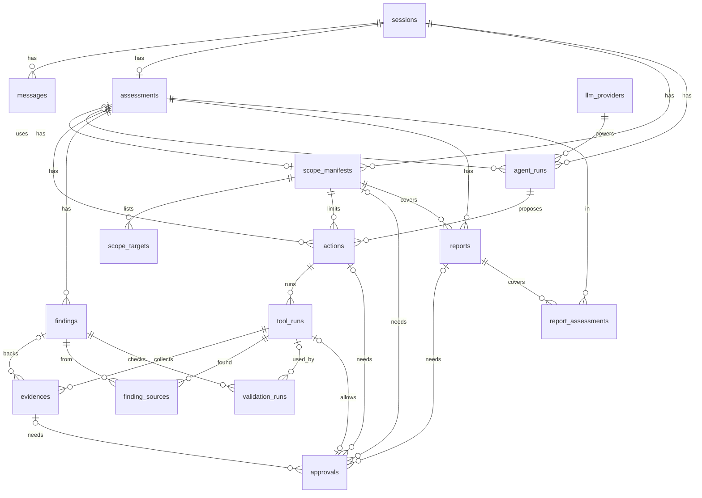

# Reconix ERD V3 (Final)

This file is the final Reconix ERD V3, written as text.
The source is the image "Reconix ERD - Reconix final V3.png".
Required fields, defaults and unique rules come from Data Dictionary V3. They match the image.

The database has **16 tables** and **13 enums**.

## How to read the tables

- **PK** = primary key. **FK** = foreign key. **PK, FK** = both.
- **Req** = Y means the field cannot be empty (NOT NULL).
- `now()` means the default is the current time.
- All ids are UUIDs and are generated automatically.

---

## 1. Enums

| Enum | Values | Used by |
|---|---|---|
| `session_status` | ACTIVE, CLOSED | sessions.session_status |
| `assessment_status` | DRAFT, ACTIVE, COMPLETED, CANCELLED | assessments.assessment_status |
| `manifests_status` | DRAFT, APPROVED, REJECTED | scope_manifests.manifests_status |
| `tool_run_status` | PENDING, RUNNING, COMPLETED, FAILED, TIMED_OUT, CANCELLED | tool_runs.tool_run_status |
| `action_status` | PENDING, APPROVED, REJECTED, COMPLETED, FAILED, CANCELLED, BLOCKED | actions.action_status |
| `risk_level` | LOW, MEDIUM, HIGH | actions.risk_level, approvals.risk_level, scope_manifests.max_risk |
| `validation_status` | CONFIRMED, UNCONFIRMED, INCONCLUSIVE | validation_runs.validation_status, findings.validation_status |
| `approval_status` | PENDING, APPROVED, REJECTED, EXPIRED | approvals.approval_status |
| `finding_status` | OPEN, FALSE_POSITIVE, FIXED | findings.finding_status |
| `agent_runs_status` | RUNNING, WAITING_APPROVAL, COMPLETED, FAILED, CANCELLED | agent_runs.agent_runs_status |
| `severity_status` | CRITICAL, HIGH, MEDIUM, LOW, UNKNOWN, NONE | findings.severity_status |
| `provider_type` | RECONIX, OPENAI, ANTHROPIC, DEEPSEEK, OLLAMA, OPENAI_API_COMPATIBLE | llm_providers.provider_type |
| `report_status` | GENERATING, READY, FAILED | reports.report_status |

---

## 2. Tables

### 2.1 sessions

One chat session from the web, the CLI or VS Code.

| Key | Column | Type | Req | Default | Notes |
|---|---|---|---|---|---|
| PK | session_id | UUID | Y | | |
| | interface | VARCHAR(20) | Y | | web, cli or vscode |
| | session_status | ENUM (session_status) | Y | ACTIVE | |
| | created_at | TIMESTAMPTZ | Y | now() | |
| | closed_at | TIMESTAMPTZ | | | Set when the session closes |

### 2.2 messages

The chat messages in a session.

| Key | Column | Type | Req | Default | Notes |
|---|---|---|---|---|---|
| PK | message_id | UUID | Y | | |
| | sequence_no | INTEGER | Y | | Unique with session_id |
| | role | VARCHAR(20) | Y | | user, assistant or system |
| | content_masked | TEXT | Y | | Secrets are masked |
| | metadata | JSONB | Y | {} | |
| | created_at | TIMESTAMPTZ | Y | now() | |
| FK | session_id | UUID | Y | | → sessions |

### 2.3 assessments

One security test. Each session has at most one assessment.

| Key | Column | Type | Req | Default | Notes |
|---|---|---|---|---|---|
| PK | assessment_id | UUID | Y | | |
| | engagement_code | VARCHAR(50) | Y | | Unique, e.g. RCX-2026-0042 |
| | name | VARCHAR(200) | Y | | |
| | type | VARCHAR(60) | Y | | e.g. web_url, network |
| | assessment_status | ENUM (assessment_status) | Y | DRAFT | |
| | created_by | VARCHAR(100) | Y | | |
| | created_at | TIMESTAMPTZ | Y | now() | |
| | updated_at | TIMESTAMPTZ | Y | now() | |
| FK | session_id | UUID | Y | | → sessions. Unique |

### 2.4 scope_manifests

The approved scope: what may be tested, and how.

| Key | Column | Type | Req | Default | Notes |
|---|---|---|---|---|---|
| PK | manifest_id | UUID | Y | | |
| | version | INTEGER | Y | 1 | Unique with session_id |
| | manifests_status | ENUM (manifests_status) | Y | DRAFT | |
| | max_risk | ENUM (risk_level) | Y | LOW | |
| | allowed_tools | JSONB | Y | [] | e.g. ["nmap", "nuclei", "zap"] |
| | allowed_actions | JSONB | Y | [] | e.g. ["discovery", "scan"] |
| | allowed_methods | JSONB | Y | [] | e.g. ["GET", "HEAD"] |
| | allowed_ports | JSONB | Y | [] | e.g. [22, 80, 443]; empty puts no limit on ports |
| | starts_at | TIMESTAMPTZ | | | Start of the test window |
| | ends_at | TIMESTAMPTZ | | | End of the test window |
| | limitations | TEXT | | | e.g. quiet hours |
| | decided_by | VARCHAR(100) | | | |
| | decided_at | TIMESTAMPTZ | | | |
| | reject_reason | TEXT | | | Only when REJECTED |
| FK | session_id | UUID | Y | | → sessions |
| FK | assessment_id | UUID | | | → assessments. Unique. Empty while draft |

### 2.5 scope_targets

The targets inside a scope manifest.

| Key | Column | Type | Req | Default | Notes |
|---|---|---|---|---|---|
| PK | scope_target_id | UUID | Y | | |
| | type | VARCHAR(20) | Y | | domain, ip, cidr, url or path (a source code folder under /workspace/code) |
| | value | TEXT | Y | | e.g. shop.acme.test |
| | excluded | BOOLEAN | Y | false | true = must not be tested |
| FK | manifest_id | UUID | Y | | → scope_manifests |

### 2.6 llm_providers

The AI model settings.

| Key | Column | Type | Req | Default | Notes |
|---|---|---|---|---|---|
| PK | llm_provider_id | UUID | Y | | |
| | provider_type | ENUM (provider_type) | Y | | |
| | display_name | VARCHAR(100) | Y | | |
| | base_url | TEXT | | | Empty for the built-in provider |
| | api_key_encrypted | BYTEA | | | Never shown |
| | api_key_last4 | VARCHAR(4) | | | For display |
| | model_name | VARCHAR(100) | Y | | |
| | is_active | BOOLEAN | Y | false | Only one active provider |
| | archived | BOOLEAN | Y | false | Removed from the lists; kept for agent runs' history (key cleared) |
| | created_by | VARCHAR(100) | Y | | |
| | created_at | TIMESTAMPTZ | Y | now() | |
| | updated_at | TIMESTAMPTZ | Y | now() | |

### 2.7 agent_runs

One run of the AI agent.

| Key | Column | Type | Req | Default | Notes |
|---|---|---|---|---|---|
| PK | agent_run_id | UUID | Y | | |
| | model_name | VARCHAR(100) | Y | | Copy of the model used |
| | checkpoint_id | TEXT | | | For resume |
| | agent_runs_status | ENUM (agent_runs_status) | Y | RUNNING | |
| | started_at | TIMESTAMPTZ | Y | now() | |
| | plan | JSONB | | | Steps the agent plans |
| | finished_at | TIMESTAMPTZ | | | |
| FK | session_id | UUID | Y | | → sessions |
| FK | assessment_id | UUID | | | → assessments. Empty before an assessment exists |
| FK | llm_provider_id | UUID | Y | | → llm_providers |

### 2.8 actions

A tool command the agent wants to run.

| Key | Column | Type | Req | Default | Notes |
|---|---|---|---|---|---|
| PK | action_id | UUID | Y | | |
| | tool | VARCHAR(100) | Y | | e.g. nmap |
| | args | JSONB | Y | [] | |
| | target | TEXT | Y | | Host or URL |
| | purpose | TEXT | Y | | discovery, scan or validation |
| | risk_level | ENUM (risk_level) | | | Empty when blocked |
| | action_status | ENUM (action_status) | Y | PENDING | |
| | guardrail_report | JSONB | Y | {} | Result of each safety check |
| | source | VARCHAR(30) | Y | agent | |
| | created_at | TIMESTAMPTZ | Y | now() | |
| FK | assessment_id | UUID | Y | | → assessments |
| FK | manifest_id | UUID | Y | | → scope_manifests (scope version in force) |
| FK | agent_run_id | UUID | Y | | → agent_runs |

### 2.9 tool_runs

One try at running an action.

| Key | Column | Type | Req | Default | Notes |
|---|---|---|---|---|---|
| PK | tool_run_id | UUID | Y | | |
| | attempt_no | INTEGER | Y | 1 | Unique with action_id |
| | tool_run_status | ENUM (tool_run_status) | Y | PENDING | |
| | exit_code | INTEGER | | | |
| | error | TEXT | | | Why it failed |
| | masked_count | INTEGER | Y | 0 | Secrets masked in output |
| | request_count | INTEGER | Y | 0 | Requests sent to the target |
| | output_masked | TEXT | | | |
| | job_token_id | UUID | Y | | Unique. Stops a token being used twice |
| | started_at | TIMESTAMPTZ | | | |
| | finished_at | TIMESTAMPTZ | | | |
| FK | action_id | UUID | Y | | → actions |
| FK | approval_id | UUID | | | → approvals. Unique. Empty when no approval is needed |

### 2.10 approvals

A person's yes or no on something risky. Each approval is used once.

| Key | Column | Type | Req | Default | Notes |
|---|---|---|---|---|---|
| PK | approval_id | UUID | Y | | |
| | kind | VARCHAR(20) | Y | | scope, action, disclosure, configuration or review |
| | subject_snapshot | JSONB | Y | | Masked copy of what was approved |
| | subject_hash | VARCHAR(64) | Y | | SHA-256 of the snapshot |
| | risk_level | ENUM (risk_level) | | | |
| | approval_status | ENUM (approval_status) | Y | PENDING | |
| | config_change | JSONB | | | Only for configuration approvals |
| | confirmation_verified | BOOLEAN | Y | false | true when the user typed the confirmation |
| | reason | TEXT | | | |
| | decided_by | VARCHAR(100) | | | |
| | requested_at | TIMESTAMPTZ | Y | now() | |
| | decided_at | TIMESTAMPTZ | | | |
| | consumed_at | TIMESTAMPTZ | | | Set when used |
| FK | action_id | UUID | | | → actions (action approvals) |
| FK | manifest_id | UUID | | | → scope_manifests (scope approvals) |
| FK | evidence_id | UUID | | | → evidences (disclosure approvals) |
| FK | report_id | UUID | | | → reports (review approvals) |

### 2.11 evidences

Proof collected by a tool run.

| Key | Column | Type | Req | Default | Notes |
|---|---|---|---|---|---|
| PK | evidence_id | UUID | Y | | |
| | kind | VARCHAR(50) | Y | | e.g. http_response, screenshot |
| | content | TEXT | | | Masked text |
| | file_path | TEXT | | | Stored file |
| | location | TEXT | | | URL, host:port or line |
| | created_at | TIMESTAMPTZ | Y | now() | |
| FK | finding_id | UUID | | | → findings. Empty until linked |
| FK | tool_run_id | UUID | Y | | → tool_runs |

### 2.12 findings

A security issue found in an assessment.

| Key | Column | Type | Req | Default | Notes |
|---|---|---|---|---|---|
| PK | finding_id | UUID | Y | | |
| | code | VARCHAR(100) | Y | | e.g. RCX-001 |
| | title | TEXT | Y | | |
| | target | TEXT | Y | | Host or URL affected |
| | description | TEXT | Y | | |
| | severity_status | ENUM (severity_status) | Y | UNKNOWN | |
| | cvss_score | NUMERIC(3,1) | | | 0.0 to 10.0 |
| | cwe_ids | JSONB | Y | [] | |
| | owasp_id | JSONB | Y | [] | |
| | cve_ids | JSONB | Y | [] | |
| | impact | TEXT | | | |
| | remediation | TEXT | | | |
| | validation_status | ENUM (validation_status) | Y | UNCONFIRMED | Same as the newest validation run |
| | finding_status | ENUM (finding_status) | Y | OPEN | |
| | reviewed_by | VARCHAR(100) | | | |
| | reviewed_at | TIMESTAMPTZ | | | |
| | dedupe_key | VARCHAR(255) | Y | | Unique with assessment_id |
| | created_at | TIMESTAMPTZ | Y | now() | |
| FK | assessment_id | UUID | Y | | → assessments |

### 2.13 finding_sources

Join table: which tool runs found which findings.

| Key | Column | Type | Req | Notes |
|---|---|---|---|---|
| PK, FK | finding_id | UUID | Y | → findings |
| PK, FK | tool_run_id | UUID | Y | → tool_runs |

### 2.14 validation_runs

A check that a finding is real.

| Key | Column | Type | Req | Default | Notes |
|---|---|---|---|---|---|
| PK | validation_run_id | UUID | Y | | |
| | method | VARCHAR(30) | Y | | e.g. poc, manual_review |
| | validation_status | ENUM (validation_status) | Y | | |
| | reason | TEXT | | | |
| | reviewed_by | VARCHAR(100) | | | |
| | reviewed_at | TIMESTAMPTZ | | | |
| | created_at | TIMESTAMPTZ | Y | now() | |
| FK | finding_id | UUID | Y | | → findings |
| FK | tool_run_id | UUID | | | → tool_runs. Empty for a manual review |

### 2.15 reports

A report for an assessment. A new version is made each time.

| Key | Column | Type | Req | Default | Notes |
|---|---|---|---|---|---|
| PK | report_id | UUID | Y | | |
| | version | INTEGER | Y | 1 | Unique with assessment_id |
| | report_status | ENUM (report_status) | Y | GENERATING | |
| | executive_summary | TEXT | | | |
| | methodology | TEXT | | | |
| | snapshot | JSONB | Y | | Frozen copy of the findings |
| | snapshot_hash | VARCHAR(64) | Y | | SHA-256 of the snapshot |
| | exports | JSONB | Y | {} | e.g. {"pdf": "..."} |
| | generated_by | VARCHAR(100) | Y | | |
| | generated_at | TIMESTAMPTZ | | | Set when READY |
| | created_at | TIMESTAMPTZ | Y | now() | |
| FK | assessment_id | UUID | Y | | → assessments |
| FK | manifest_id | UUID | Y | | → scope_manifests |

### 2.16 report_assessments

Join table: which assessments a report covers.

| Key | Column | Type | Req | Notes |
|---|---|---|---|---|
| PK, FK | assessment_id | UUID | Y | → assessments |
| PK, FK | report_id | UUID | Y | → reports |

---

## 3. Links between tables

"Required" means the FK cannot be empty. "Optional" means it can be empty.

| # | From (FK) | To | Type | Required? |
|---|---|---|---|---|
| 1 | messages.session_id | sessions | many to one | Required |
| 2 | assessments.session_id | sessions | one to one | Required |
| 3 | scope_manifests.session_id | sessions | many to one | Required |
| 4 | scope_manifests.assessment_id | assessments | one to one | Optional |
| 5 | scope_targets.manifest_id | scope_manifests | many to one | Required |
| 6 | agent_runs.session_id | sessions | many to one | Required |
| 7 | agent_runs.assessment_id | assessments | many to one | Optional |
| 8 | agent_runs.llm_provider_id | llm_providers | many to one | Required |
| 9 | actions.assessment_id | assessments | many to one | Required |
| 10 | actions.manifest_id | scope_manifests | many to one | Required |
| 11 | actions.agent_run_id | agent_runs | many to one | Required |
| 12 | tool_runs.action_id | actions | many to one | Required |
| 13 | tool_runs.approval_id | approvals | one to one | Optional |
| 14 | approvals.action_id | actions | many to one | Optional |
| 15 | approvals.manifest_id | scope_manifests | many to one | Optional |
| 16 | approvals.evidence_id | evidences | many to one | Optional |
| 17 | approvals.report_id | reports | many to one | Optional |
| 18 | evidences.tool_run_id | tool_runs | many to one | Required |
| 19 | evidences.finding_id | findings | many to one | Optional |
| 20 | findings.assessment_id | assessments | many to one | Required |
| 21 | finding_sources.finding_id | findings | many to one | Required |
| 22 | finding_sources.tool_run_id | tool_runs | many to one | Required |
| 23 | validation_runs.finding_id | findings | many to one | Required |
| 24 | validation_runs.tool_run_id | tool_runs | many to one | Optional |
| 25 | reports.assessment_id | assessments | many to one | Required |
| 26 | reports.manifest_id | scope_manifests | many to one | Required |
| 27 | report_assessments.assessment_id | assessments | many to one | Required |
| 28 | report_assessments.report_id | reports | many to one | Required |

So findings and tool_runs are many to many (through finding_sources).
Reports and assessments are also many to many (through report_assessments).

## 4. Unique rules

| Table | Unique on |
|---|---|
| messages | (session_id, sequence_no) |
| assessments | engagement_code |
| assessments | session_id |
| scope_manifests | (session_id, version) |
| scope_manifests | assessment_id |
| tool_runs | (action_id, attempt_no) |
| tool_runs | job_token_id |
| tool_runs | approval_id |
| findings | (assessment_id, dedupe_key) |
| reports | (assessment_id, version) |
| llm_providers | Only one row with is_active = true |

## 5. Diagram (Mermaid)

